# Rapport de qualification — AI-TestGuard

**Étudiant :** Mohamed KABORE — **Module :** Test logiciel — **Enseignant :** M. Moustapha DER
**Dépôt :** [github.com/Maho226/AI-TestGuard](https://github.com/Maho226/AI-TestGuard) — **Modèle qualifié :** v2 (version active), comparé à la référence v1

## 1. Contexte et périmètre

**Contexte.** Une institution financière envisage un modèle d'apprentissage automatique qui attribue à chaque transaction par carte une probabilité de fraude. Une fraude non détectée (faux négatif) est une perte financière directe ; une transaction légitime bloquée (faux positif) dégrade l'expérience client et occupe les analystes. L'objectif n'est pas d'obtenir le meilleur score, mais de **démontrer, preuves à l'appui, si le système peut poursuivre vers une phase pilote**.

**Données.** Jeu *Credit Card Fraud Detection* (Kaggle) : 284 807 transactions sur deux jours, 492 fraudes (0,17 %), variables `Time`, `V1`–`V28` (composantes PCA anonymisées), `Amount`, cible `Class`. 1 081 doublons stricts ont été supprimés **avant** la séparation. Le jeu complet n'est pas versionné ; un échantillon de 5 492 lignes (492 fraudes + 5 000 normales) l'est pour la CI.

**Périmètre évalué :** qualité des données, prétraitement, entraînement, seuil, prédiction, sauvegarde/rechargement, robustesse, non-régression, performance, sécurité opérationnelle, intégration continue, surveillance.
**Hors périmètre :** API de service, intégration au système d'autorisation, validation réglementaire, audit d'équité (impossible faute d'attributs, § 9).

## 2. Plan de test et matrice de traçabilité

Le plan complet (exigences, risques, contrat des données, critères fixés avant évaluation, scénarios de robustesse) est dans [`docs/plan_de_test.md`](plan_de_test.md).

| ID | Exigence | Preuve | Statut |
|---|---|---|---|
| T01 | Colonnes nécessaires présentes | `test_preprocessing.py` | Réussi |
| T02 | Types numériques conformes | `test_preprocessing.py` | Réussi |
| T03 | Aucune valeur non finie en sortie | `test_preprocessing.py` | Réussi |
| T04 | Probabilité finie dans [0, 1] | `test_prediction.py` | Réussi |
| T05 | Test indépendant du réglage | `test_integration.py` | Réussi |
| T06 | Reproductibilité (écart ≤ 1e-9) | `test_regression.py` | Réussi |
| T07 | Tests exécutés sur GitHub | workflow `tests.yml`, captures § 10 | Réussi |
| T08 | Cible limitée à {0, 1} | `test_preprocessing.py` | Réussi |
| T09 | Rejets explicites des entrées invalides | `test_preprocessing.py`, `test_prediction.py` | Réussi |
| T10 | Aucune fuite entre les jeux | `test_integration.py` | Réussi |
| T11 | Stratification (± 0,02 point) | `test_integration.py` | Réussi |
| T12 | Seuil choisi sur la validation | `test_integration.py` | Réussi |
| T13 | Critères d'acceptation sur le test | `reports/non_regression_v1_v2.json` | **Échec** (rappel 0,747 < 0,75) |
| T14 | Sauvegarde/rechargement identiques | `test_integration.py` | Réussi |
| T15 | Réaction contrôlée aux perturbations | `test_robustness.py`, `reports/robustesse_*.csv` | Réussi (sensibilités documentées) |
| T16 | Non-régression vs référence figée | `test_regression.py`, `reports/non_regression_v1_v2.json` | Réussi sur l'échantillon CI ; « à investiguer » sur le jeu complet (§ 7) |
| T17 | Latence, débit, taille, mémoire | `test_performance.py`, `reports/performance_v2.json` | Réussi |
| T18 | Aucun secret ni donnée exposés | `test_security.py`, `test_prediction.py` | Réussi |
| T19 | Ruff sans erreur, couverture ≥ 80 % | job `qualite` et `tests` | Réussi (couverture 89 %) |

**18 exigences sur 19 sont satisfaites. L'exigence non satisfaite (T13) est l'exigence métier principale.**

## 3. Architecture du pipeline et choix méthodologiques

```
CSV ─► load_data ─► validate_data ─► remove_duplicates ─► preprocess_data ─► split_data
       extension,   contrat des      avant la             ordre, float64     60/20/20
       taille       données          séparation                              stratifié
                                                                                 │
Pipeline : [log(1 + Amount)] ─► StandardScaler ─► Régression logistique  ◄───────┘
   réglage (PR-AUC) et seuil ─► validation uniquement
   évaluation finale         ─► test, une seule fois
                                     │
save_model ─► load_model ─► predict_fraud ─► alertes (montant, plage)
SHA-256,      intégrité,                 └─► monitoring_report (PSI, taux signalé)
métadonnées   schéma
```

| Choix | Justification |
|---|---|
| Doublons supprimés avant la séparation | Une même transaction ne peut pas être à la fois en entraînement et en test (fuite) |
| Séparation 60/20/20 stratifiée, graine 42 | ≈ 95 fraudes dans validation et test ; résultats reproductibles |
| Transformations dans un `Pipeline` | Le scaler n'est ajusté que sur l'entraînement (vérifié par T10) |
| Pondération des classes | Compense le déséquilibre (1 fraude pour 600 transactions) |
| Hyperparamètres, seuil et modèle choisis sur la validation | Le test reste une mesure non biaisée |
| Seuil : précision maximale sous contrainte rappel ≥ 0,80 (validation) | Rappel prioritaire ; marge de 0,05 au-dessus du critère |
| Métriques : rappel, précision, FPR, PR-AUC, ROC-AUC + IC bootstrap | L'accuracy est trompeuse (« toujours normal » = 99,83 %) |
| Critères d'acceptation fixés avant l'évaluation | Évite d'ajuster les critères aux résultats |

**Versions.** v1 : régression logistique, `class_weight="balanced"`, C ∈ {0,01 ; 0,1 ; 1} (retenu C = 0,01). v2 : ajout de `log(1 + Amount)` et pondération des fraudes w ∈ {1, 10, 50}, C ∈ {0,1 ; 1} (retenu C = 1, w = 10). Un arbre de décision a été comparé et écarté (précision 0,13 sur le test).

**Vérification sur le jeu complet.** 1 081 doublons supprimés, taux de fraude identique dans les trois jeux (0,167 %), aucune transaction commune entre entraînement et test.

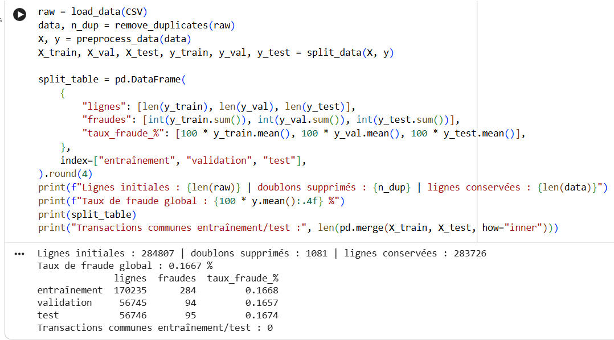

## 4. Tests unitaires et d'intégration

| Fichier | Tests | Contenu |
|---|---|---|
| `test_preprocessing.py` | 36 | Schéma, types, NaN/infinis, montant négatif, cible, doublons, chargement (extension, taille, fichier illisible), stratification |
| `test_prediction.py` | 25 | Probabilités valides, seuil, métriques sur cas calculables à la main, règle de seuil, décision d'acceptation |
| `test_integration.py` | 16 | Pipeline de bout en bout, fuite par le scaler et par les doublons, test non utilisé au réglage, sauvegarde/rechargement (≤ 1e-9) |
| `test_robustness.py` | 17 | Bruit, montants extrêmes, entrées invalides, tests par propriétés (Hypothesis) |
| `test_regression.py` | 13 | Reproductibilité, comparaison à la référence figée `reports/baseline_ci.json` |
| `test_security.py` | 8 | Secrets dans le dépôt, fichiers reçus, intégrité SHA-256 du modèle, journaux |
| `test_monitoring.py` | 7 | PSI, taux de signalement, alertes |
| `test_performance.py` | 6 | Latence, débit, taille, mémoire (marqués `slow`) |
| **Total** | **128** | **122 rapides + 6 lents, tous réussis ; couverture du code de app : 89 %** |

Les tests utilisent des données synthétiques ou l'échantillon versionné : ils ne dépendent pas du jeu complet. Les rapports d'exécution sont dans `reports/tests_unitaires.txt`, `tests_integration.txt` et `tests_robustesse.txt`.

**Défauts trouvés par les tests :** le test de fuite par le scaler dépendait de la structure du pipeline (avec ou sans l'étape `log_amount`) et a échoué : il a été corrigé pour cibler l'étape du scaler par son nom, quelle que soit sa position.

## 5. Métriques et matrices de confusion

Évaluation sur le jeu de **test** (56 746 transactions, 95 fraudes).

| Métrique | Référence naïve | Arbre | v1 | v2 | Critère |
|---|---|---|---|---|---|
| Accuracy | 0,9983 | 0,9907 | 0,9994 | 0,9993 | non utilisée |
| Rappel | 0 | 0,789 | 0,726 | **0,747** | ≥ 0,75 |
| Précision | 0 | 0,129 | 0,885 | 0,826 | ≥ 0,30 |
| FPR | 0 | 0,893 % | 0,016 % | 0,026 % | ≤ 0,1 % |
| PR-AUC | 0,0017 | 0,628 | 0,674 | 0,703 | ≥ 0,70 |
| ROC-AUC | 0,5 | 0,893 | 0,964 | 0,959 | ≥ 0,95 |
| VP / FN / FP | 0 / 95 / 0 | 75 / 20 / 506 | 69 / 26 / 9 | 71 / 24 / 15 | |
| **Décision** | | | **Rejeté** | **Rejeté** | |

**Intervalles de confiance à 95 % (bootstrap, v2) :** rappel [0,660 ; 0,828], précision [0,743 ; 0,897], FPR [0,014 % ; 0,041 %]. L'intervalle du rappel contient le seuil de 0,75 : avec 95 fraudes, **une fraude de plus ou de moins déplace le rappel de 0,011**. Le résultat n'est donc ni nettement acceptable ni nettement insuffisant.

**Interprétation.** La référence naïve atteint 99,83 % d'accuracy sans détecter une seule fraude : l'accuracy n'est pas un critère. v2 détecte 71 fraudes sur 95 ; les 24 fraudes manquées sont des pertes directes. En contrepartie, 15 transactions légitimes sur 56 651 sont bloquées, soit environ une fausse alerte pour cinq alertes : charge d'analyse très supportable.

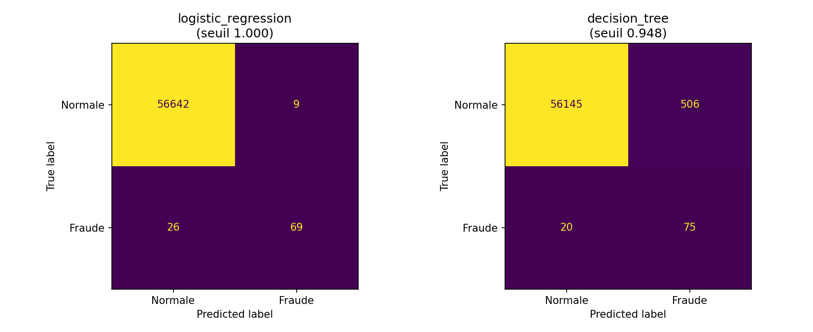

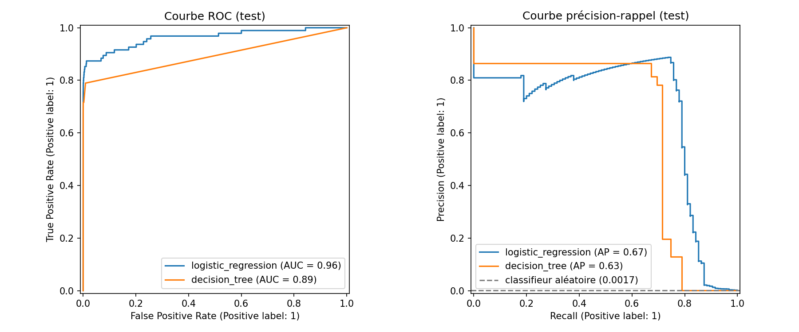

**Analyse des erreurs (v1).** Les 26 fraudes manquées sont surtout des **petits montants** (médiane 2,99, contre 33,59 pour les fraudes détectées) ; leurs probabilités vont de 0,005 à presque 1 : une partie est confondue avec des transactions normales, une autre tombe juste sous le seuil. Les 9 fausses alertes portent sur des montants plus élevés (médiane 89,99) et, comme les fraudes détectées, ont toutes une probabilité de 1,0 : le modèle ne peut pas les départager, ce qui a révélé la saturation des probabilités (anomalie A1).

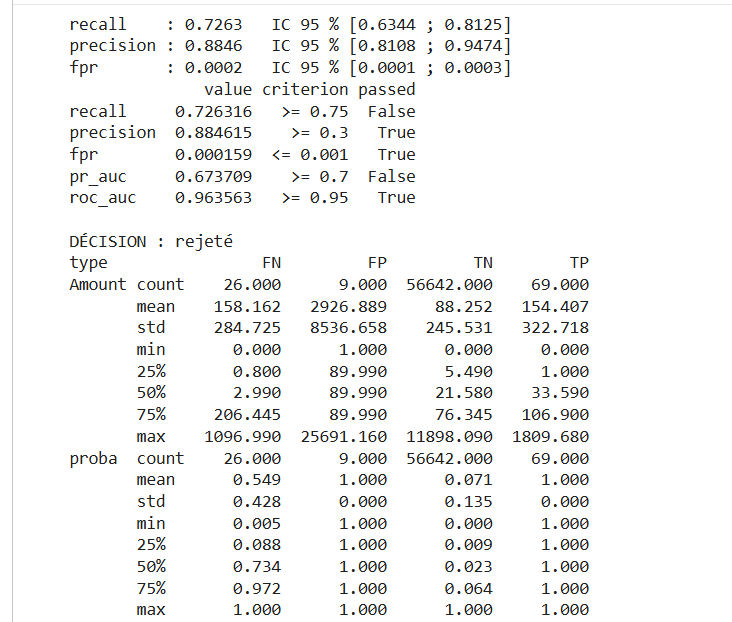

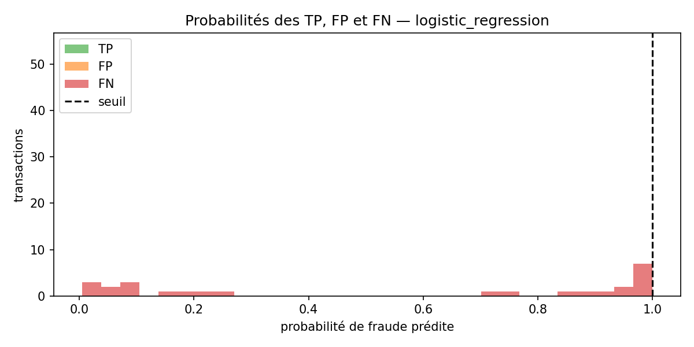

**Écart validation / test.** Rappel v1 : 0,809 en validation → 0,726 en test ; v2 : 0,819 → 0,747. La marge de 0,05 prévue pour le seuil est **insuffisante** (anomalie A2).

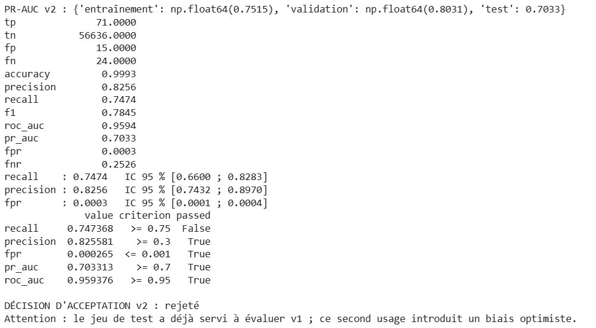

## 6. Tests de robustesse

Perturbations appliquées au jeu de validation, en conservant les labels. Bruit gaussien de k × l'écart-type d'entraînement sur V1–V28 ; variation relative du montant ; `Time` non perturbé.

| Scénario | v1 : changements de classe | v1 : effet | v2 : changements de classe | v2 : effet |
|---|---|---|---|---|
| Bruit V1–V28 10 % | 0 | aucun | 1 | précision 0,811 → 0,802 |
| Amount ± 20 % | 0 | aucun | — | — |
| Amount × 3 (inflation) | **104** | précision 0,884 → **0,400**, FPR × 11 | 2 | précision 0,811 → 0,804 |
| V14 + 1 écart-type | 4 | rappel 0,809 → 0,766 | 7 | rappel 0,819 → 0,755 |

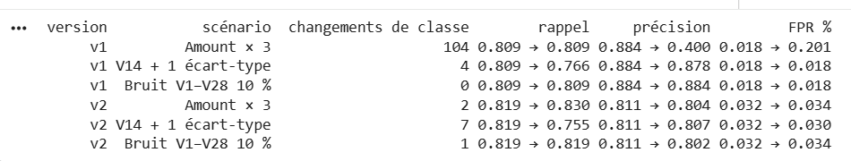

**Entrées invalides et extrêmes** (`reports/robustesse_scenarios.csv`) : valeur manquante, infinie, non numérique, montant négatif, colonne manquante ou inconnue → **toutes rejetées** avec un message explicite ; montants 10× et 1 000× le maximum d'entraînement → traités, probabilités valides, **alerte** `montant_eleve`.

**Conclusion.** v1 était fortement sensible à l'échelle des montants (A3) ; v2 corrige ce défaut. Les deux versions restent sensibles à un décalage de V14, la variable la plus discriminante : c'est attendu, mais ce décalage reste **dans la plage** des valeurs d'entraînement et n'était pas détecté (A4, corrigé par la surveillance PSI, § 9). On mesure une sensibilité, on n'affirme pas une invariance.

## 7. Non-régression

La référence v1 est figée dans `reports/baseline_v1.json` (code, paramètres, environnement, empreinte SHA-256 du jeu, seuil, métriques de validation) et **n'est jamais recalculée automatiquement**. v2 est comparée sur le **même jeu de validation**.

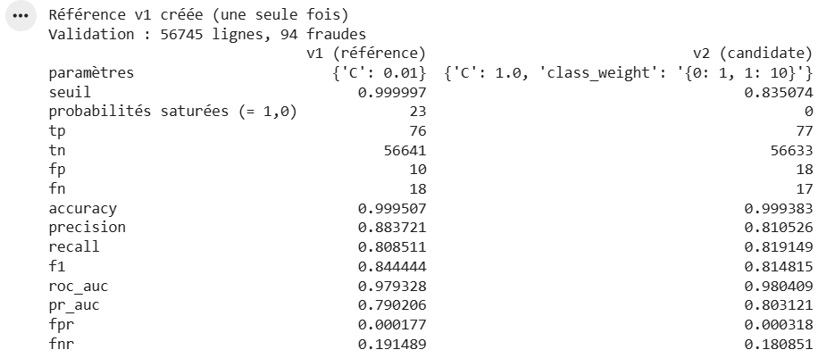

| Métrique (validation) | v1 (référence) | v2 | Écart | Tolérance | Régression |
|---|---|---|---|---|---|
| PR-AUC | 0,790 | 0,803 | + 0,013 | 0,02 | non |
| Rappel | 0,809 | 0,819 | + 0,011 | 0,03 | non |
| Précision | 0,884 | 0,811 | **− 0,073** | 0,05 | **oui** |
| FPR | 0,018 % | 0,032 % | + 0,014 pt | 0,05 pt | non |

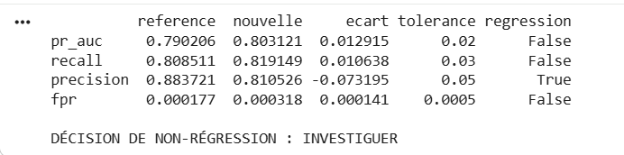

**Décision : « à investiguer »** (écart de précision supérieur à la tolérance mais inférieur au double). Investigation : la baisse de précision correspond à 8 fausses alertes supplémentaires sur 56 651 transactions, en échange de la suppression de la saturation des probabilités (23 probabilités à exactement 1,0 en v1, 0 en v2, anomalie A1) et de la sensibilité au montant (A3). v2 a été **acceptée comme base technique** et fusionnée par la Pull Request #2.

Dans la CI, la même comparaison est faite sur l'échantillon versionné contre `reports/baseline_ci.json` : elle conclut « accepter ». L'échantillon (9 % de fraudes) est **moins sensible** que le jeu complet : la CI détecte les régressions grossières, pas les écarts fins.

## 8. Latence et consommation de ressources

Protocole : `time.perf_counter`, 50 appels d'échauffement, 1 000 prédictions isolées, 5 répétitions par taille de lot ; Google Colab, 2 cœurs logiques, 13,6 Go, Python 3.13.

| Mesure | Valeur | Critère | Respecté |
|---|---|---|---|
| Latence P95 d'une prédiction isolée, modèle seul | 8,1 ms | — | — |
| Latence P95 avec contrôle des entrées | 16,1 ms (P99 22,6 ms) | ≤ 50 ms | Oui |
| Débit, lot de 1 000 | ≈ 78 900 / s | ≥ 1 000 / s | Oui |
| Débit, lot de 10 000 | ≈ 538 600 / s | — | — |
| Taille du modèle | 0,004 Mo | ≤ 10 Mo | Oui |
| Pic mémoire, lot de 10 000 | 12,1 Mo | ≤ 200 Mo | Oui |

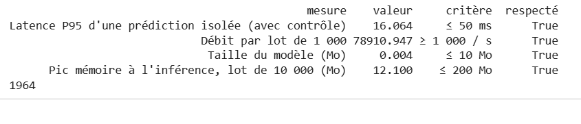

Le contrôle des entrées double la latence mais reste largement dans le critère. Une API ajouterait le traitement HTTP et la sérialisation JSON, non mesurés. Les mesures sur Colab (machine partagée) sont variables : ce sont des ordres de grandeur.

**Sécurité opérationnelle.** Aucun secret dans les fichiers suivis par Git (test automatisé, jeton GitHub stocké dans les secrets Colab) ; fichiers reçus limités à `.csv` et 500 Mo ; colonnes inconnues rejetées ; journaux limités à des comptages, sans valeur de transaction ; modèle accompagné de son empreinte SHA-256, vérifiée au chargement (joblib/pickle peut exécuter du code : seuls des fichiers de confiance sont chargés).

## 9. Biais et surveillance

**Biais.** Le jeu ne contient aucun attribut client : **aucune conclusion sur l'équité n'est possible** et aucun attribut n'a été inféré des composantes V1–V28. Détails, données nécessaires et méthode (Fairlearn, AIF360) : [`docs/audit_biais.md`](audit_biais.md).

**Surveillance.** En production, les labels arrivent avec retard (contestations). Deux indicateurs sont donc suivis **sans labels** : la dérive de chaque variable (PSI sur les déciles d'entraînement, `Time` exclu ; > 0,10 à surveiller, > 0,25 alerte) et le taux de transactions signalées (alerte s'il sort de [÷2 ; ×2] du taux attendu de 0,167 %).

| Scénario simulé | PSI max | Taux signalé | Alerte |
|---|---|---|---|
| Lot normal | 0,001 | 0,167 % | aucune |
| V14 + 1 écart-type | 1,418 (V14) | 0,155 % | dérive importante V14 (non détectée par les alertes de plage) |
| Amount × 3 | 0,417 (Amount) | 0,171 % | dérive importante Amount |
| Panne : tout est signalé | 0,001 | 100 % | taux de signalement |

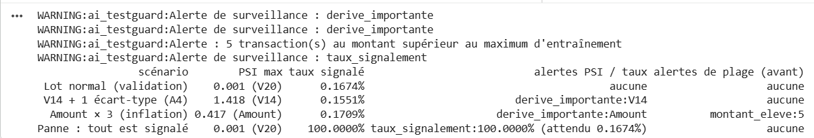

**Jour 1 / jour 2 (validation).** Le jour 2 présente une dérive réelle (PSI V1 = 1,60, V3 = 1,44) sans dégradation du rappel (0,789 → 0,865) : une dérive des données n'implique pas une dérive du concept. Avec des seuils non calibrés, l'alerte se déclencherait chaque jour (A5). Le rappel ne peut être suivi qu'une fois les labels connus.

## 10. Intégration continue

Workflow `.github/workflows/tests.yml` : job `qualite` (Ruff : règles et formatage), job `tests` (Pytest hors tests lents, couverture ≥ 80 %, rapports JUnit et couverture en artefacts), job `performance` (manuel ou hebdomadaire). La branche `main` est protégée : Pull Request et réussite des deux contrôles obligatoires.

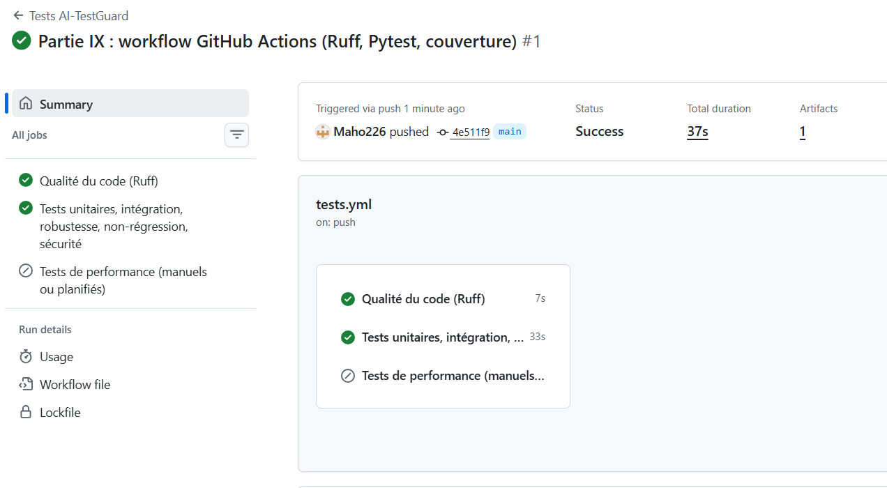

**Démonstration d'un échec.** Un défaut a été introduit volontairement sur une branche (contrôle des montants négatifs désactivé) : la CI l'a détecté et a bloqué la fusion ; la Pull Request #1 a été fermée sans fusion.

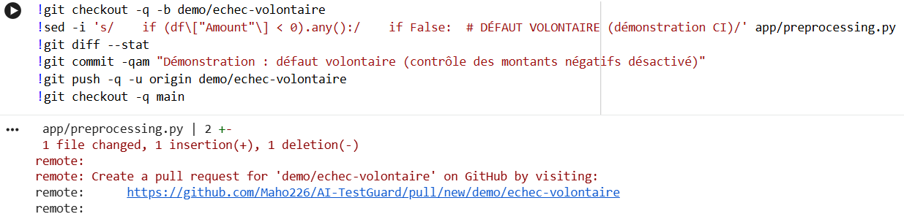

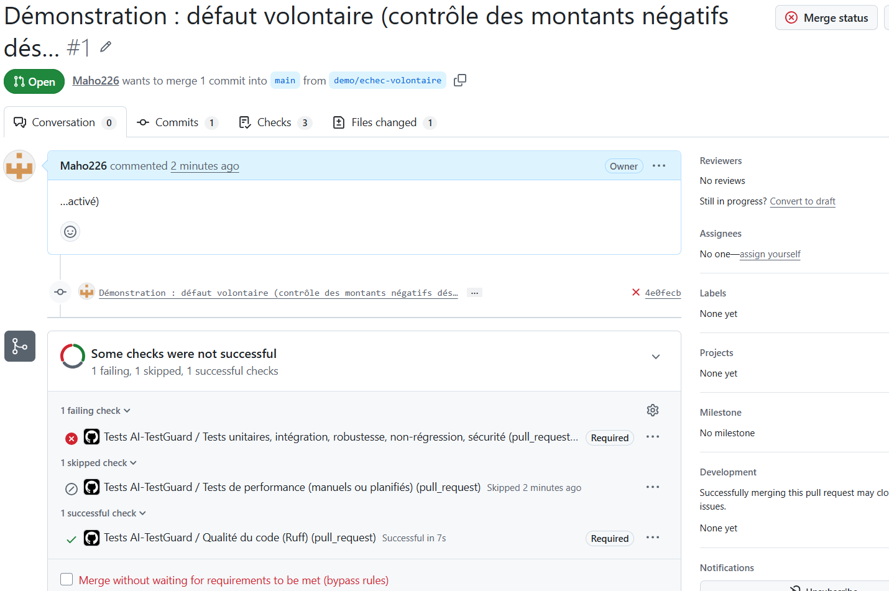

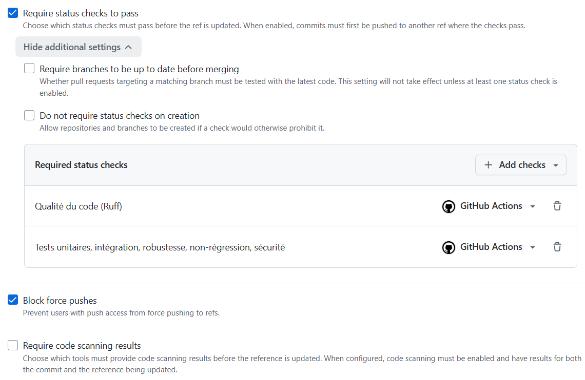

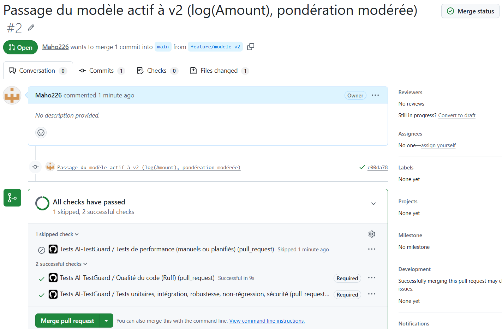

## 11. Anomalies

| ID | Description | Gravité | Statut |
|---|---|---|---|
| A1 | v1 : 23 probabilités saturées à 1,0 ; seuil à 0,999997, classement impossible entre ces transactions | Majeure | **Corrigée** (v2 : 0 saturation) |
| A2 | Écart validation → test du rappel (≈ − 0,08) ; marge de 0,05 du seuil insuffisante | Majeure | **Ouverte** |
| A3 | v1 : Amount × 3 fait chuter la précision de 0,88 à 0,40 | Majeure | **Corrigée** (v2 : log(1 + Amount)) |
| A4 | Un décalage de V14 dans la plage d'entraînement n'est pas détecté par les alertes de plage | Moyenne | **Corrigée** (PSI) |
| A5 | Seuils PSI non calibrés : la variation naturelle entre jours déclencherait des alertes quotidiennes | Moyenne | **Ouverte** |
| A6 | v2 : rappel sur le test 0,747 < 0,75 | **Bloquante** | **Ouverte** |

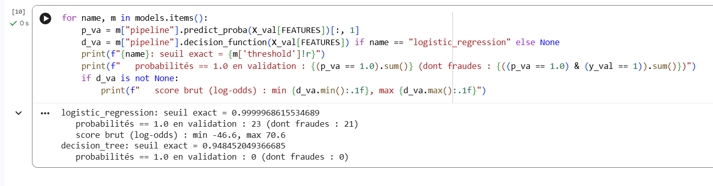

## 12. Limites de l'évaluation et risques résiduels

- **Réutilisation du jeu de test.** Le test a été consulté pour v1, puis pour v2 : le résultat de v2 est légèrement optimiste. Une nouvelle version devra être évaluée sur des données jamais vues.
- **Faible nombre de fraudes.** 95 fraudes dans le test : intervalle du rappel de ± 0,08 environ.
- **Deux jours de données (septembre 2013).** Pas de saisonnalité, pas d'évolution des fraudeurs ; la dérive constatée entre deux jours montre que la stabilité à long terme n'est pas démontrée.
- **Variables anonymisées.** Impossible d'expliquer les décisions aux métiers et d'auditer l'équité.
- **Labels possiblement incomplets.** Fraudes non détectées à l'époque comptées comme normales.
- **Coûts non chiffrés.** Le compromis faux positifs / faux négatifs repose sur des critères, pas sur un coût réel.
- **Performance mesurée hors API**, sur une machine partagée.
- **Non-régression CI sur un échantillon** moins sensible que le jeu complet.

## 13. Décision

**Réussite technique.** Le système réussit les tests techniques : 128 tests automatisés, contrat des données appliqué, aucune fuite, résultats reproductibles, sauvegarde fiable, robustesse documentée, performance très au-delà des besoins, sécurité opérationnelle de base, CI bloquante, surveillance opérationnelle.

**Aptitude au pilote : non.** Le modèle v2 **n'est pas autorisé à poursuivre vers une phase pilote** :

1. le critère métier principal n'est pas atteint (rappel 0,747 < 0,75, anomalie bloquante A6) ;
2. son intervalle de confiance [0,66 ; 0,83] ne permet pas d'affirmer que le modèle détecte trois fraudes sur quatre ;
3. ce résultat est déjà optimiste (jeu de test réutilisé).

v2 est conservé comme **base technique** : il corrige A1 et A3 et satisfait tous les autres critères.

**Réussir les tests ≠ être autorisé à déployer.** Même si le rappel avait été atteint, la décision n'aurait été qu'une **acceptation technique pour un pilote**. Le déploiement exige en plus une validation **métier** (coûts, charge des analystes), **opérationnelle** (intégration, exploitation, plan de retour arrière), **sécuritaire** (API, accès, audit) et **réglementaire** (protection des données, explicabilité, équité).

**Actions recommandées :** (1) relever la contrainte de rappel du seuil en validation (≥ 0,85) ou utiliser une validation croisée stratifiée pour réduire l'écart A2 ; (2) essayer un modèle non linéaire (gradient boosting) pour les fraudes à faible montant ; (3) évaluer la nouvelle version sur des données récentes jamais utilisées ; (4) calibrer les seuils PSI sur plusieurs semaines (A5).

## 14. Question de synthèse

> *Dans quelles conditions votre modèle peut-il être considéré comme suffisamment fiable pour être testé dans un environnement pilote, et quelles preuves supplémentaires seraient nécessaires avant une mise en production réelle ?*

**Conditions pour un pilote.** Le modèle pourra entrer en pilote lorsque :

- **tous les critères fixés à l'avance seront respectés sur des données jamais utilisées**, en particulier un rappel ≥ 0,75 dont la **borne basse de l'intervalle de confiance** reste acceptable pour les métiers. Aujourd'hui, v2 atteint 0,747 avec un intervalle [0,66 ; 0,83] : la preuve est insuffisante. Avec environ 95 fraudes par jeu, il faut davantage de fraudes (plus de données ou une validation croisée) pour réduire cette incertitude ;
- **aucune anomalie bloquante ne sera ouverte** : A6 doit être levée, A2 corrigée (seuil plus prudent) ;
- les **garanties techniques déjà démontrées restent vraies** à chaque version : contrat des données, absence de fuite, reproductibilité, non-régression par rapport à une référence figée, latence P95 ≤ 50 ms (16 ms mesurées), CI bloquante ;
- le pilote est **encadré** : mode observation (le modèle signale sans bloquer) ou blocage soumis à un analyste, surveillance PSI et du taux de signalement active, seuils d'arrêt définis à l'avance et retour arrière possible.

**Preuves supplémentaires avant la production :**

- **performance dans la durée** : résultats du pilote sur plusieurs semaines, avec labels confirmés, rappel et FPR suivis dans le temps, sur des données récentes et non sur deux jours de 2013 ;
- **validation métier** : coût réel des fraudes manquées et des blocages, capacité des analystes, seuil validé par les métiers ;
- **calibration de la surveillance** : seuils PSI calibrés sur la variabilité normale (A5), procédure de réentraînement et de revalidation ;
- **équité** : audit par groupe de clients avec des attributs légalement utilisables (impossible avec ce jeu) ;
- **explicabilité** : capacité à justifier un blocage auprès d'un client ou d'un régulateur, ce que les variables anonymisées ne permettent pas ;
- **sécurité et exploitation** : tests de l'API (charge, authentification), stockage signé du modèle, journalisation d'audit, plan de reprise ;
- **conformité réglementaire** : protection des données personnelles, exigences du régulateur bancaire et validation par les fonctions de contrôle (risques, conformité).

En résumé, **la réussite des tests techniques est une condition nécessaire, mais pas suffisante** : elle montre que le système fonctionne comme prévu, pas que ses décisions sont assez bonnes, stables et justifiables pour être appliquées à de vrais clients.
